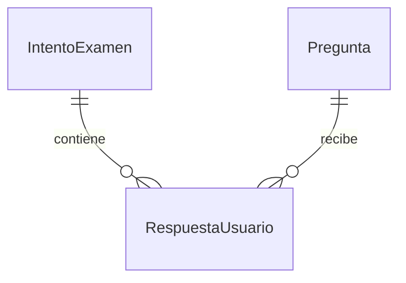

# Actualización: audio MP3, panel docente e informes PDF

Consulta [AUDIO-ADMIN-INFORMES.md](AUDIO-ADMIN-INFORMES.md) para configurar el servidor, crear la contraseña docente y preparar los audios. Estas funciones necesitan backend HTTPS; GitHub Pages sirve únicamente la interfaz.

> **Actualización v3 — ES/NL, sesiones controladas y evaluación productiva.** Lee primero [Investigación y seguridad](INVESTIGACION-Y-SEGURIDAD.md). La web publicada sigue siendo estática: la IA real y el control de tiempo desde servidor requieren conectar un backend HTTPS. La pantalla de Preferencias distingue expresamente conexión ausente, demostración y proveedor configurado. Las funciones y límites de v3 de este bloque sustituyen las descripciones históricas de v2 que aparecen más abajo.

## Novedades v3 / Nieuw in v3

- Selector ES / NL / ES+NL, instrucciones bilingües explícitas en las 18 tareas y avisos procedimentales. Los estímulos y respuestas lingüísticas siguen en español.
- Página de protocolos de examen y privacidad. Las incidencias de foco no generan acusaciones ni descuentos automáticos. Sin cámara ni biometría.
- Rúbrica `formativa-mcer-2.0`: evidencias verificables, feedback ES/NL, abstención y propuesta pendiente de revisión humana.
- `POST /api/evaluar-audio`: en desarrollo, decodifica, comprueba duración/silencio, transcribe y propone análisis parcial. Audio temporal eliminado después. `pronunciacion`, `fluidez` y `nivel_oral_global` permanecen null. El original local y el análisis parcial pueden conservarse en el portafolio.
- Modo `/api/secure/*`: códigos de un uso, tokens de 256 bits almacenados como hash, caducidad, control de revisiones, reloj y secuencia de servidor, recepción autorizada y archivos privados. El frontend no decide la puntuación de este modo.
- Producción bloquea las rutas antiguas sin autorización y exige `SECURE_BANK_PATH` con un banco privado distinto al material público. Un código autoriza acceso, no verifica identidad.
- El decodificador nativo FFmpeg/ffprobe se instala en Docker. Los procesos tienen límite temporal y no usan shell. No se ha realizado una auditoría de penetración ni un estudio psicométrico.

### Probar el modo de servidor

Desde `backend`, instalar requisitos y disponer de FFmpeg y ffprobe en PATH. En Windows indicar las rutas absolutas en `.env` si procede. Para una prueba local:

```powershell
$env:ENVIRONMENT='development'
$env:FRONTEND_ORIGIN='http://localhost:5173'
.venv\Scripts\python -m uvicorn app.main:app --host 127.0.0.1 --port 8000
# En una segunda terminal, desde backend, con la misma DATABASE_URL:
.venv\Scripts\python -m app.issue_ticket --modality S2 --hours 1
```

El último comando emite un código aleatorio **privado**. Entregarlo al candidato por un canal adecuado; no subir códigos al repositorio. En la web, configurar el backend en Preferencias, abrir Sesión controlada e introducir el código. El token se guarda en `sessionStorage`, no en una URL. La copia de emergencia de borradores tampoco permite modificar respuestas cerradas.

Para producción usar `ENVIRONMENT=production`, TLS y `SECURE_BANK_PATH=/data/private-bank.json`. El banco usa el mismo esquema/códigos canónicos de tareas que `bank.json`, pero sus estímulos e ítems deben ser privados, diferentes y contar con autorización de uso. Mantenerlo fuera del directorio web y de GitHub. Antes de usarlo con estudiantes reales, validar el banco, la accesibilidad, los tiempos y la operativa del centro.

### Revisión docente y conservación

```powershell
.venv\Scripts\python -m app.review_cli ID_DEL_INTENTO revision.json
.venv\Scripts\python -m app.cleanup
```

`revision.json` contiene `reviewer`, `task_id`, `criterios` (bandas propias 0–4), `observaciones_es`, `observaciones_nl` y, para oral, `audio_escuchado: true`. Solo se ejecuta en el servidor por un operador autorizado; no es una ruta del candidato. La revisión no certifica SIELE. Las propuestas automáticas quedan auditadas como antecedentes. Las sesiones caducan a las 24 h; la limpieza horaria, mientras el servicio esté activo, elimina los registros expirados y sus grabaciones.

### Verificación v3

27 pruebas: 10 del motor/bilingüismo y 17 de backend, seguridad y propuestas de audio. TypeScript y compilación de producción pasan. Se verificó en navegador el selector NL, las instrucciones ES/NL y una sesión con código, recepción y recuperación del reloj/respuesta tras recargar. Los proveedores de IA y el decodificador de los tests se simulan; no se ha probado una clave real, un micrófono físico o un despliegue productivo del backend. La imagen Docker contiene FFmpeg, pero no se ha construido en este entorno.

---

# Fontys Español · Laboratorio de lenguas

**Diseñado por Daniel Valle Robles.** Plataforma de práctica A1–C1 orientada a estudiantes de formación de profesores de español de Fontys Hogeschool. Material original, sin afiliación ni aval institucional. No certifica niveles, no emite certificados y no es una réplica oficial de SIELE.

## Ver y usar

- **Sin instalar:** abrir `Abrir plataforma.html`. Contiene la interfaz, el banco y las ilustraciones. Para micrófono y audio persistente es preferible localhost o HTTPS; `file://` depende del navegador.
- **Desarrollo:** iniciar el frontend con las instrucciones siguientes. Funciona sin backend ni clave de IA.
- **Publicación:** ver `PUBLICAR.md`. Incluye flujo de GitHub Actions para pruebas y GitHub Pages. Publicar código en un repositorio y tener una web desplegada son dos pasos distintos.

## Funciones implementadas

| Área | Funciones |
|---|---|
| Inicio | Progreso real del navegador, acceso a cuatro destrezas y reanudación de intentos |
| Simulacros | Global; S1 CL+CA; S2 CL+EIE; S3 CA+EIO; S4 EIO; S5 EIE+EIO |
| Lectura | 5 tareas: mensajes, correo, relación de textos, reconstrucción y selección en huecos; 38 ítems |
| Escucha | 6 tareas: banco de opciones, preguntas, relación de intervenciones, entrevista, fragmentos y selección de ideas; 38 respuestas puntuables |
| Escritura | Respuesta a mensaje y argumentación con dos opciones; borrador y contador de palabras |
| Oral | Cuatro preguntas personales; elección de escena; elección de situación personal y pública; tres preguntas sobre un tema; argumentación sobre el mismo tema con elección de afirmación |
| Control | Cronómetro absoluto por sección, avance al agotarse, cierre sin retroceso en comprensión/oral, navegación entre las dos tareas escritas, descanso Global tras escucha |
| Práctica | Actividades individuales sin límite global, filtros y transcripción disponible |
| Ruta adaptativa | Doce preguntas originales; cambio de nivel objetivo por regla propia; sin equivalencia psicométrica |
| Portafolio | Textos, audios locales, soluciones razonadas, reflexión, informe Markdown, impresión y exportación JSON |
| Laboratorio docente | Seis fichas: diseño, apoyos, observación, reflexión, interculturalidad y feedback; exportación Markdown |
| Accesibilidad | Menú móvil, navegación por teclado, etiquetas, foco visible, texto ampliado, contraste reforzado y reducción de animaciones |
| Privacidad | Alias, almacenamiento local, exportación y borrado; envío explícito al backend opcional |

La selección de seis ideas en la última tarea auditiva aporta **seis** aciertos máximos. No se premia como acierto adicional dejar una idea distractora sin seleccionar. La ruta adaptativa puntúa solo las preguntas presentadas.

## Arranque del frontend

Requisitos: Node 22.12+ y npm (Node 24 para las pruebas de TypeScript ejecutadas directamente).

```powershell
cd frontend
npm install
npm run dev
```

Abrir la URL que imprime Vite, normalmente http://localhost:5173. En Windows también se puede ejecutar `INICIAR.ps1` desde PowerShell. El frontend no espera a que exista FastAPI: la pantalla inicial y todas las prácticas funcionan por sí mismas.

```powershell
npm test
npm run build
cd ..
node scripts/standalone.mjs
```

`frontend/dist` es el resultado para hosting estático. El `base` relativo permite una ruta de repositorio en GitHub Pages. `Abrir plataforma.html` se regenera con el último comando. El lock de pnpm está incluido para CI: `pnpm install --frozen-lockfile`, `pnpm test` y `pnpm build`. El script de esbuild está permitido explícitamente en `pnpm-workspace.yaml`.

## Backend opcional

Requisitos: Python 3.11+.

```powershell
cd backend
python -m venv .venv
.venv\Scripts\python -m pip install -r requirements.lock.txt
Copy-Item .env.example .env
.venv\Scripts\python -m uvicorn app.main:app --reload --host 127.0.0.1 --port 8000
```

Documentación interactiva: http://127.0.0.1:8000/docs. SQLite y preguntas iniciales se crean al arrancar. No subir bases, audios ni claves al repositorio. `requirements.txt` expresa rangos; el lock registra las versiones verificadas. Las migraciones posteriores requieren una herramienta como Alembic; `create_all` no migra bases existentes.

En Preferencias de la web indicar la dirección del backend. Su origen CORS debe coincidir con el de la web. Para una página HTTPS se necesita un backend HTTPS, salvo excepciones locales que dependen del navegador.

| Variable de backend/.env | Valor o finalidad |
|---|---|
| DATABASE_URL | `sqlite:///./simulador.db` |
| UPLOAD_DIR | `./uploads`, privado |
| AI_MODE | `demo` o `openai` |
| OPENAI_API_KEY | Clave propia, exclusivamente en servidor |
| OPENAI_MODEL | Ejemplo configurable: `gpt-4.1-mini`; requiere acceso y soporte de salida estructurada |
| FRONTEND_ORIGIN | Por defecto `http://localhost:5173`; en Pages, origen sin ruta |
| MAX_AUDIO_BYTES | 10485760 (10 MiB) |

En demo no hay llamadas de pago ni notas ficticias. Para feedback real, activar `AI_MODE=openai`, configurar la clave y reiniciar. El texto y la consigna se envían al proveedor cuando el estudiante lo solicita. `store=False` no equivale a ausencia de toda retención del proveedor. No se ha probado una llamada real con clave en esta entrega.

## Modelo y endpoints

`backend/schema.sql` contiene el DDL. Las tablas son:

- `Pregunta`: id PK, destreza, nivel_mcer, contenido_estimulo, opciones_json, respuesta_correcta y metadatos_calibracion JSON. El nivel indica objetivo; no dificultad empírica ni parámetro IRT.
- `IntentoExamen`: id PK, usuario_id seudónimo, fecha UTC, estado y puntaje_global nullable. El puntaje permanece NULL porque el feedback no se convierte a escala oficial.
- `RespuestaUsuario`: id PK, intento_id FK, pregunta_id FK, respuesta_dada, calificacion_ia JSON y retroalimentacion_ia. Una respuesta tiene texto o nombre privado de grabación. La evaluación guarda modo, modelo y versión de rúbrica.



| Ruta | Función |
|---|---|
| GET /api/salud | Estado y modo |
| GET /api/preguntas | Consignas públicas, sin claves |
| POST /api/intentos | Crea intento con usuario_id |
| POST /api/evaluar-escritura | Contrato inicial: intento_id, pregunta_id, texto; evalúa y persiste |
| POST /api/audio | Multipart intento_id, pregunta_id, archivo; recibe y persiste |
| POST /api/evaluar-tarea | Adaptador de la nueva web: task_id (`eie-1`/`eie-2`), opcion, texto; feedback sin persistencia central |
| POST /api/audio-practica | Multipart task_id oral, parte, archivo; recepción central opcional desde el informe |

La web usa guardado local y solo envía datos al servidor al pulsar los botones correspondientes. Los endpoints iniciales conservan su contrato de SQLite; la evaluación por tarea devuelve feedback al portafolio local. Cada envío de audio crea un intento técnico independiente. No se implementa sincronización entre esos intentos y las sesiones del navegador.

Validaciones: IDs positivos, texto no vacío, máximo 15000 caracteres, rechazo de campos extra, referencia de consigna y parte oral válidas, destreza correcta e intento abierto en el contrato inicial. JSON de IA validado y citas comprobadas contra el texto. Errores 404/409/422, 413 tamaño, 415 formato, 503 evaluación indisponible o no verificable.

Audio: MediaRecorder, Blob, IndexedDB, reproducción y descarga; FormData al solicitar envío. WebM/Ogg/MP4 con firma de contenedor y límite por bloques. No se decodifica el archivo ni se prueba que contenga solo audio. Guardar localmente es distinto de enviar al servidor. Los audios recibidos quedan **sin evaluar**. Se detienen las pistas al terminar o abandonar el componente; se bloquea cambiar de pantalla durante grabación/guardado. Al agotarse la sección se intenta guardar antes de avanzar.

## Organización

```text
backend/app/       configuración, SQLAlchemy, esquemas, evaluación y API
backend/tests/     contratos y respuestas de IA simuladas
frontend/src/     App, Runner, Recorder, AudioPlayer, Results, motor y almacenamiento
frontend/public/  banco original e ilustraciones SVG
frontend/tests/   reglas de puntuación, modalidades, tiempo y adaptación
scripts/          generación del banco y HTML autocontenido
.github/workflows/pages.yml  pruebas y despliegue
```

Para ampliar el banco editar `scripts/build_bank.py` y ejecutar `python scripts/build_bank.py`. Volver a compilar y regenerar el HTML. Materiales y claves de corrección en el cliente son apropiados para práctica, no para un examen supervisado de consecuencias importantes.

## Relación con SIELE, MCER y Fontys

Las seis modalidades se contrastaron con [Cervantes, comparación DELE/SIELE revisada en octubre de 2025](https://www.cervantes.es/imagenes/File/lengua/evaluaycertifica/diferencias-examenes-ic-dele-siele.pdf). La estructura detallada se basó en la [guía oficial SIELE de abril de 2021 alojada por Cervantes](https://seul.cervantes.es/imagenes/File/guia_de_examen_SIELE.pdf). Es documentación histórica accesible en la consulta del 29-10-2026, no garantía de que cada detalle operativo siga igual.

SIELE es **multinivel**. No se ha encontrado documentación oficial que lo describa como selección adaptativa de ítems después de cada respuesta. La ruta adaptativa de esta web es una función pedagógica propia. No se reproducen materiales oficiales, marca gráfica, escalas de puntuación ni certificados. Los audios se sintetizan con las voces disponibles en el navegador; las escenas son ilustraciones originales, no fotografías de examen. Los textos pueden tener longitudes distintas a las oficiales. La dificultad no está calibrada. Los tiempos internos de preparación y audio son ajustes de práctica, no réplica exacta del programa oficial. El simulacro usa 20 minutos de oral, y por ello Global suma 185 minutos más descanso; otras descripciones oficiales indican 15 minutos y 180 en total.

La formación contextual se orienta por la [información pública de Leraar Spaans deeltijd de Fontys](https://www.fontys.nl/Opleidingen/Leraar-Spaans-bachelor-deeltijd.htm): desarrollo lingüístico y cultural, diseño y mejora de clases, acompañamiento y contextos de enseñanza. El objetivo B2 del perfil es personalizable; no se afirma que esta plataforma cumpla un programa institucional aprobado.

La rúbrica `formativa-mcer-2.0` es una síntesis propia de [descriptores generales MCER](https://www.coe.int/en/web/common-european-framework-reference-languages/cefr-descriptors). Los campos gramática, coherencia, vocabulario y cumplimiento (0–4) no son las escalas oficiales de SIELE. No se convierten sus sumas a MCER ni a puntos SIELE. El proveedor utiliza [Structured Outputs de OpenAI](https://developers.openai.com/api/docs/guides/structured-outputs): el esquema controla forma, no validez del juicio.

La evaluación puede abstenerse (`nivel_estimado=null`) y señalar revisión humana. Menos de 30 palabras fuerza abstención: umbral técnico propio, no corte oficial. Una cita literal verificable no prueba que la interpretación sea correcta. Una sola muestra ni un recorrido adaptativo de doce ítems permiten estimar competencia global. Para uso evaluativo real se necesitan pilotaje, corpus con doble corrección y adjudicación, estudios de acuerdo y estabilidad, análisis por grupo/variedad y validación de cortes. No se presuponen esos resultados.

## Privacidad y límites de despliegue

La web no tiene cuentas, base de datos institucional, panel multiusuario ni autenticación Fontys. LocalStorage guarda textos y metadatos; IndexedDB guarda Blobs. Exportar JSON no incluye audio binario: descargar cada grabación desde el informe. No hay importación automática del JSON ni sincronización. El modo privado, la cuota del navegador o borrar datos pueden impedir o eliminar guardados; se muestran errores y se ofrece descarga. El reloj usa fecha absoluta y continúa al cerrar, pero la suspensión del navegador puede retrasar eventos: no es un control de tiempo de examen supervisado.

Antes de exponer el backend con una clave de pago: añadir autenticación, autorización, cuotas, limitación de solicitud en proxy, HTTPS, retención y copias de seguridad. La API inicial permite operar con IDs conocidos; no debe publicarse como servicio institucional sin esas protecciones. GitHub Pages sirve solo la web local y no requiere ese backend.

## Verificación

```powershell
cd frontend
npm test
npm run build
cd ../backend
.venv\Scripts\python -m pytest -q
```

Se comprueban modalidades y tareas, 38 respuestas por comprensión, selección múltiple sin puntos espurios, descanso, expiración, doce ítems sin repetición, validaciones de texto/audio, evidencia literal y abstención de IA. Las pruebas del proveedor usan un doble local, sin llamada de pago. Se comprobó en navegador el recorrido de lectura y su persistencia. No se ha validado un micrófono físico ni autenticación o funcionamiento multiusuario.

Resultados finales: **7 pruebas del motor y 6 del backend aprobadas**; TypeScript y compilación de producción correctos. En navegador: lectura completa con 5/5; escritura con elección y recuperación del borrador tras recarga; ruta adaptativa de doce preguntas; conservación de tema entre tareas orales 4 y 5; configuración S5 y revisión de pantalla móvil. La comprobación directa de `file://` no se realizó porque el navegador de verificación solo admite HTTP/HTTPS.
